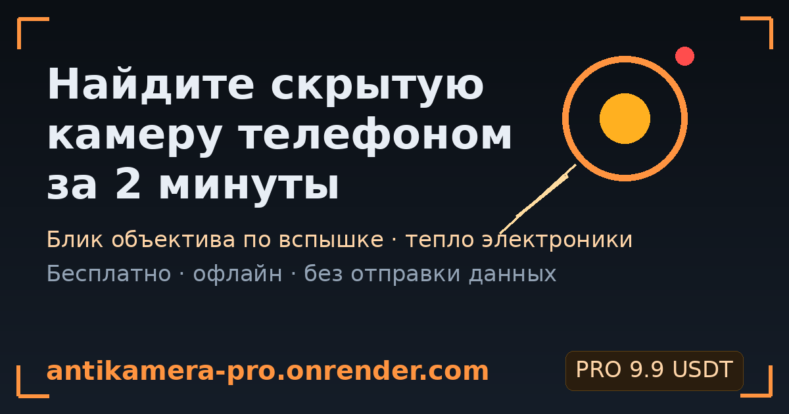

# 🛡️ AntiCamera PRO · АнтиКамера PRO

**Find hidden cameras with your phone — honest physics, no gimmicks.**
**Найти скрытую камеру телефоном — честная физика, без «магии».**



**🟢 Live app:** **https://antikamera-pro.onrender.com** · [Buy PRO page](https://antikamera-pro.onrender.com/landing/) · [Русская страница покупки](https://antikamera-pro.onrender.com/landing/) · [English purchase page](https://antikamera-pro.onrender.com/en/)

---

## Why it's different / Чем отличается

Most "hidden camera detector" apps are junk — they wave a magnetometer and beep. This project is built on the two methods security experts actually recommend, automated:

| Mode | How it works | Physics |
|---|---|---|
| 🔦 **Lens glare** | The phone's flash pulses in a rhythm; the app flags glints that blink **in sync with the flash** | Lens retro-reflection: a camera objective glints light straight back. Random glossy surfaces (chrome, table polish) don't sync — a lens does. |
| 🌡️ **Thermal** | Load a video from a thermal camera (USB-C InfiRay/Topdon/FLIR One or a built-in one); the app finds small **persistent** warm spots | Powered electronics dissipates heat. Filters out cooling coffee cups (temperature decay), moving people, radiators (too big). |

**Cross-check rule: heat + glint at the same spot = almost certainly a device.**

Everything runs **on-device, offline** (it's a PWA — installs on Android/iOS from the browser). No data ever leaves the phone.

## Honest limits / Честные ограничения

- A powered-off camera doesn't glow thermally; a matte/recessed lens may not glint — no phone app is a 100% guarantee;
- Thermal mode needs a thermal video source (USB-C modules from ~$100); glare mode works on **any** phone with a flash (on iOS via browser the flashlight can't blink — Apple restriction — continuous mode is used; native app planned).

## Business model (open source core, PRO licence)

- Core detectors: **free forever**;
- **PRO 9.9 USDT** (one-time, TRC20): fine-tuning, full log, report export;
- **Fully autonomous checkout** (this repo!): the built-in Node server verifies the buyer's USDT payment directly in the TRON blockchain and instantly issues a license code — no manual work, no third-party payment processor;
- **AML screening included**: before issuing a code, the payer's address is checked against OFAC sanctions lists, hacker/darknet/mixer databases (PublicAML Intelligence + a local blocklist) — payments from flagged sources are declined and the owner is alerted;
- Monitoring: sales/feedback/AML alerts to the owner's Telegram, health endpoint, self-keepalive.

## Run your own instance

```bash
ADMIN_KEY=your-secret PORT=8083 node autosale/server.js
# app:    http://localhost:8083/
# sales:  http://localhost:8083/landing/
# admin:  http://localhost:8083/admin?key=your-secret
```

No dependencies (pure Node.js ≥ 18). Deploy-ready: `render.yaml` and `Dockerfile` included — see `marketing/DEPLOY_GUIDE.md` in the developer workspace or `DEPLOYED.md` for the architecture overview.

## Repo structure

```
index.html            — PWA app (both detectors, demo modes, RU UI)
landing/index.html    — RU sales page (auto code delivery)
en/index.html         — EN sales page
autosale/server.js    — autonomous sales server: blockchain verification,
                        AML screening, license codes, alerts, admin panel
manifest.json, sw.js  — PWA offline install
```

## Status

Tested with automated test suites: glare detector (blink-sync classification), thermal detector (persistence/cooling/movement filters), license code generation, payment verification (11 tests), server-side code validation, AML screening (10 tests). Detection algorithms are ported 1:1 between web and the native Flutter skeleton (`flutter/antikamera_pro` in the dev workspace).

⭐ If this is useful, a star helps others find it.

*Use only to protect your own privacy, lawfully. Not a certified security device.*
